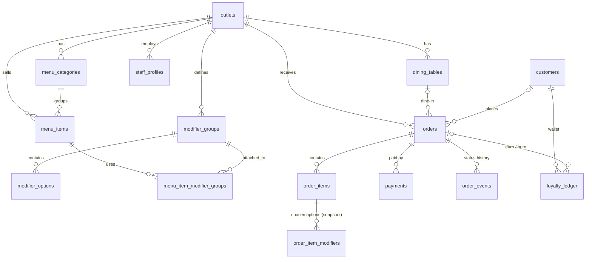

# Unified QR Ordering & Loyalty Platform: Architecture & Migration Plan

Sources inspected (shallow clones, 2026-10-17):

- `heaventech-store/ngachoan-qr-order` (called **NGA** below)
- `taha-contractor/Digital-Menu-Ordering-System` (called **DMO** below)

Deliverables in this folder:

| File | What it is |
|---|---|
| `supabase/migrations/20261017000000_unified_schema.sql` | Full schema: tables, enums, RLS, triggers, RPC API, analytics views |
| `supabase/seed.sql` | NBC-style demo outlet: Size variation, paid add-ons, 10 tables |
| `supabase/tests/schema.test.mjs` | 43 checks on embedded Postgres (PGlite): pricing, GST, tokens, approvals, loyalty, RLS. All pass |

---

## 1. What the two repos actually contain

### NGA: `ngachoan-qr-order` (React 18 + Vite + Tailwind + Supabase, ~800 LOC)

| Area | Reality in code |
|---|---|
| "Backend" | **No server.** `src/supabaseClient.js` connects straight to Supabase Postgres. |
| "WebSocket / Socket.io engine" | **No Socket.io.** Supabase Realtime `postgres_changes` on `orders` (`DapurView.jsx`, `OwnerView.jsx`). |
| Data model | One `orders` table: `id, id_order_fintech, table_number, items (JSON), total_price, status, created_at`. Status values are `UNPAID → PENDING → PROCESSING → DONE`. |
| Menu | Hardcoded array in `src/data/menuData.js` (6 items, IDR prices). There is no menu table. |
| Kitchen Display (`DapurView.jsx`) | Lists PENDING/PROCESSING orders, re-fetches everything on any change. "Print & Cook" button sets PROCESSING; "Done" sets DONE. |
| Thermal printing | `window.print()` + `.print-area` 58 mm CSS. Prints a kitchen ticket only; there's no customer bill. |
| Owner Analytics (`OwnerView.jsx`) | Pulls today's DONE orders and computes revenue and best-sellers **in the browser**. |
| Payment | **Simulated client-side**: inserts `UNPAID`, shows `alert()`s, then the *browser itself* updates the row to `PENDING`. |
| Auth / roles | Supabase email login; roles = **hardcoded emails** (`dapur@ngachoan.com`, `owner@ngachoan.com`) checked in the client. |
| Routing | `?page=dapur`, `?page=owner`, `?meja=MEJA-IT-01`. |

### DMO: `Digital-Menu-Ordering-System` (React 19 + Vite 7 + Tailwind + Firebase, ~3,400 LOC)

| Area | Reality in code |
|---|---|
| Backend | Firebase Auth + Firestore (+ Storage for images). Collections: `menu`, `orders`, `staff`, `settings/app`, `activityLogs`. |
| Customer UI (`pages/CustomerMenu.jsx`, 655 LOC, one file) | Search, category and price filters; menu grid; cart modal with qty ±; checkout modal (name/phone/email); tax from `settings.taxPercent`; "Your orders at this table" live list; order-placed screen; PDF bill (`utils/pdf.js`, jsPDF); audio cues (`customer.mp3`). Uses framer-motion and lucide-react. |
| Staff (`StaffDashboard.jsx`) | Live order list, status `Pending/Preparing/Ready/Served/Completed/Cancelled`, new-order sound. |
| Admin (`AdminDashboard.jsx`, 1,007 LOC) | Menu CRUD (flat: name/desc/price/category/image/available), staff CRUD, settings, reports, QR generator. |
| QR (`QRCodeGenerator.jsx`) | `/menu?table=T1`, image from third-party `api.qrserver.com`. |
| Routing | react-router 7: `/menu`, `/staff-dashboard`, `/admin/dashboard`, logins. |

### Gaps against the target, in both repos

No modifiers or add-ons, no loyalty, no takeaway or tokens, no GST split (DMO has a single `taxPercent`), no real payment integration, and no server-side price validation (both trust prices sent by the browser).

---

## 2. Architecture decision

**Supabase is the single backend.** NGA's backbone is Supabase, so in practice "use NGA as the backbone" means:

- **Keep:** Supabase Postgres + Auth + Realtime, NGA's KDS flow and 58 mm print area, and NGA's Owner analytics screen. All are upgraded.
- **Port:** DMO's customer UI/UX, admin CRUD screens, audio cues, PDF bill, and QR generator. They get re-pointed from Firestore to Supabase.
- **Drop:** Firebase entirely. Running two backends for one order lifecycle is the main thing to avoid.
- **Socket.io is not needed.** Supabase Realtime already gives sub-second pushes:
  - **Staff** (KDS, Owner): `postgres_changes` on `orders`/`order_items`, filtered by RLS to the staff member's outlet.
  - **Diners** (anonymous): **Broadcast-from-database** on topic `order:<tracking_key>`, sent by a trigger (`broadcast_order_update`). Diners can't read the `orders` table at all.
- **Business logic lives in Postgres** (`SECURITY DEFINER` RPCs), plus **two small Edge Functions** for the parts that need secrets (Razorpay and staff creation). There's no separate Node server to host or scale.

```
 Diner phone (React SPA /menu)          Staff tablets (React SPA /kds, /owner)
   │  supabase.rpc('place_order')          │  rpc('set_order_status')
   │  rpc('get_order_tracking')            │  select … (RLS: own outlet)
   │  channel('order:<key>') broadcast     │  channel postgres_changes(orders)
   ▼                                       ▼
 ┌─────────────────────── Supabase ───────────────────────────┐
 │ Postgres: schema + RLS + RPCs + triggers (tokens, GST,     │
 │           invoice no., loyalty ledger, status broadcast)   │
 │ Auth: phone OTP (customers) · email/password (staff)       │
 │ Edge Fn: razorpay-create-order · razorpay-webhook ·        │
 │          staff-admin (service-role user creation)          │
 └────────────────────────────────────────────────────────────┘
```

---

## 3. Unified database schema

Full DDL is in `supabase/migrations/20261017000000_unified_schema.sql`. Conventions: money is **integer paise**, rates are **basis points**, and 1 coin = ₹1.



| Table | Purpose | Key columns |
|---|---|---|
| `outlets` | Replaces DMO `settings/app` and NGA's hardcoded header | `slug`, `gstin`, `cgst_rate_bp`=250, `sgst_rate_bp`=250, `loyalty_earn_bp`, `loyalty_max_redeem_bp`, `upi_vpa`, `razorpay_enabled`, `pay_at_counter_enabled`, `token_start/end`, `invoice_prefix` |
| `staff_profiles` | Replaces hardcoded emails and DMO `staff/{uid}` | `user_id → auth.users`, `role ∈ owner/manager/cashier/kitchen` |
| `dining_tables` | QR targets | `label` ("5"), `qr_key` (optional anti-prank key) |
| `menu_categories`, `menu_items` | Menu | `base_price_paise`, `is_veg` (FSSAI mark), `is_available` (86 toggle), `hsn_sac` |
| `modifier_groups` | **Variations & add-ons engine** | `min_select`, `max_select`. Size = `1/1` (required radio); Add-ons = `0/3` (optional checkboxes) |
| `modifier_options` | e.g. Large, Extra Shot | `price_delta_paise` (+₹40 = 4000) |
| `menu_item_modifier_groups` | Reuse one group across many items | `(menu_item_id, group_id)` |
| `customers` | Phone-OTP identity and wallet cache | `phone` (E.164, unique), `auth_user_id`, `coin_balance ≥ 0` |
| `loyalty_ledger` | **Append-only Earn & Burn ledger** | `entry_type ∈ earn/burn/reversal/adjustment/expiry`, `coins` ±, `balance_after`, unique earn/burn per order |
| `orders` | Header with full GST bill | `mode`, `table_id`, `token_number`, `business_date`, `invoice_number`, `status`, `payment_method`, `payment_status`, `subtotal/taxable/cgst/sgst/round_off/grand_total_paise`, `coins_redeemed`, `coins_earned`, lifecycle timestamps |
| `order_items` | Line items as snapshots | `item_name`, `base_price_paise`, `modifiers_paise`, generated `unit_price_paise`, `line_total_paise` |
| `order_item_modifiers` | Selected options as snapshots | `group_name`, `option_name`, `price_delta_paise` |
| `payments` | Razorpay / UPI / counter records | `provider_order_id`, `provider_payment_id`, `upi_ref` (UTR), `verified_by` |
| `order_events` | Status audit trail; replaces DMO `activityLogs` | `from_status → to_status`, `actor` |
| `token_counters`, `invoice_counters` | Gap-free daily tokens and per-FY GST invoice serials | |

### Order state machine

```
                ┌── razorpay ──► awaiting_payment ──(webhook: mark_order_paid)──┐
place_order ────┤                       └─(cashier)─► cancelled                  │
                └── upi_intent / pay_at_counter ──► awaiting_approval            │
                         (cashier approves on KDS) ─► placed ◄───────────────────┘
                         (cashier rejects)        ─► rejected  (coins returned)
placed ─► preparing ─► ready ─► completed  (coins earned, customer stats)
placed / preparing / ready ─(manager)─► cancelled  (coins returned)
```

Customer-facing labels: `awaiting_*` = "Waiting for confirmation", `placed` = **Placed**, `preparing` = **Preparing**, `ready` = **Ready for Pickup** (takeaway) or "On its way" (dine-in).

### Billing formula (in `place_order`)

```
line      = (base + Σ option deltas) × qty
subtotal  = Σ line
redeem    = min(coin_balance, floor(subtotal × max_redeem% / ₹1))    -- whole coins
taxable   = subtotal − redeem × ₹1
CGST      = round(taxable × 2.5%)      SGST = round(taxable × 2.5%)
total     = round_to_rupee(taxable + CGST + SGST)    (round_off shown as a separate line)
earn      = floor(taxable × earn%)  -- credited only when status → completed
```

Verified example (tested): 2× Cappuccino (Large +₹40, Extra Shot +₹40) + Fries (Cheese Dip +₹30) = ₹700 + ₹17.50 CGST + ₹17.50 SGST = **₹735**.

---

## 4. Data mapping: legacy → unified

| Legacy | Unified |
|---|---|
| NGA `menuData.js` items (`id, name, category, price, image, description`) | `menu_categories` (distinct `category`), `menu_items` (`price × 100 → base_price_paise`, `image → image_url`). Prices are IDR demo data; re-price in INR. |
| DMO `menu/{id}` (`name, description, price, category, image, available`) | Same as above; `available → is_available`. Export with a one-off Firestore → CSV script, then load with `\copy`. |
| DMO `settings/app` (`taxPercent, restaurantName, logoURL, contact, address, phone`) | `outlets` (`name, logo_url, address, phone`). `taxPercent` is replaced by `cgst_rate_bp + sgst_rate_bp`. |
| DMO `staff/{uid}.role` (`admin`/`staff`) | `staff_profiles.role` (`admin→owner` or `manager`, `staff→cashier` or `kitchen`). Users must be re-created in Supabase Auth (passwords can't be exported from Firebase without the hash-config import). |
| NGA `orders.status` `UNPAID / PENDING / PROCESSING / DONE` | `awaiting_payment / placed / preparing / completed` |
| DMO `orders.status` `Pending / Preparing / Ready / Served / Completed / Cancelled` | `placed / preparing / ready / completed / completed / cancelled` |
| NGA `orders.items` JSON, DMO `orders.items` array | `order_items` + `order_item_modifiers` rows. Historic orders are optional to import; if imported, use one `order_items` row per JSON entry with `modifiers_paise = 0`. |
| NGA `?meja=MEJA-IT-01`, DMO `?table=T1` | `/menu?table=5[&k=qr_key]`. Keep `meja` as an alias so already-printed QRs still work. |
| DMO `activityLogs` | `order_events` (orders); menu/staff audit can come later. |

---

## 5. Component migration map: DMO UI → NGA backbone APIs/state

`CustomerMenu.jsx` (655 lines, one component) is split into focused components under `src/customer/`. Every Firestore call is replaced as follows:

| DMO source (file:lines) | New component | Connects to (unified API / state) | Change required |
|---|---|---|---|
| `CustomerMenu.jsx:9-11` `urlParams.get('table') \|\| 'T1'` | `useOrderContext()` hook | URL `?table=&k=` or `?mode=takeaway`; `VITE_OUTLET_SLUG` | Remove the silent `'T1'` fallback. No table means takeaway mode. |
| `:95-99` `onSnapshot(collection 'menu')` | `useMenu()` (TanStack Query) | `supabase.from('menu_categories').select('*, menu_items(*, menu_item_modifier_groups(sort_order, modifier_groups(*, modifier_options(*))))')` + realtime on `menu_items`/`modifier_options` for 86'd items | Nested select returns item → groups → options in one round-trip. |
| `:101-122` `getDoc settings/app` | `useOutlet()` | `supabase.from('outlets').select().eq('slug', …)` | Drives name, logo, enabled modes, payment methods, GST rates. |
| `:126-148` search / category / price filters | `MenuFilters`, `CategoryTabs` | Local state over `useMenu()` data | Keep DMO's search. Use NGA's horizontal sticky category chips (better on mobile than DMO's `<select>`). Add a Veg-only toggle. |
| `:469-500` menu card + "Add to Cart" | `MenuItemCard` | `addToCart` → opens `ItemCustomizerSheet` if the item has groups | Show veg/non-veg dot and "Bestseller" tag; price "from ₹180". |
| **new** | `ItemCustomizerSheet` | Item's `modifier_groups`; radio when `max_select = 1`, checkbox otherwise; disables "Add" until every `min_select` is met | Live price = base + Σ deltas × qty. |
| `:151-186` `cart` state, `addToCart/updateQuantity/getCartTotal` | `useCartStore` (Zustand, persisted to `localStorage` per outlet) | Line key = `item_id + sorted option_ids` so "Large + Extra Shot" and "Regular" are separate lines | `getCartTotal` becomes `computeBill()`, mirroring the SQL formula for instant UI; the server is the source of truth. |
| `:505-580` cart modal | `CartSheet` | `useCartStore`, `useWallet()` | Bottom sheet (NGA style). Shows modifiers under each line, the **Redeem N coins** toggle, and a CGST/SGST/round-off breakdown. |
| `:583-651` checkout modal (name/phone/email) | `CheckoutSheet` → `PhoneOtpStep` → `PaymentMethodPicker` | `supabase.auth.signInWithOtp({ phone })` → `verifyOtp` → `rpc('upsert_my_customer')` → `rpc('get_my_wallet')` | OTP is optional ("Skip, I don't want coins"). Drop email. |
| `:189-253` `placeOrder()` → `addDoc(orders)` | `usePlaceOrder()` | `supabase.rpc('place_order', { p: { outlet_slug, mode, table_label, table_key, payment_method, redeem_coins, items: [{ menu_item_id, quantity, option_ids }] } })` | **Send IDs only, never prices.** Then branch on `payment_method`: Razorpay → Edge Fn `razorpay-create-order` → Checkout.js; UPI → open `upi://pay?pa=&pn=&am=&cu=INR&tn=Token%20104`; counter → go to the status screen. Save `tracking_key` in `localStorage`. |
| `:256-265` `onSnapshot(doc orders/id)` | `useOrderTracking(trackingKey)` | `rpc('get_order_tracking')` + `supabase.channel('order:'+key).on('broadcast', {event:'status'})` | |
| `:301-330` "Order Placed!" screen | `OrderStatusScreen` (`/o/:trackingKey`) | Same as above | Big **#104** token, 3-step progress *Placed → Preparing → Ready for Pickup*, "+7 coins on completion". Play `customer.mp3` on `ready`. |
| `:58-92` "Your Orders (Table N)" via `where tableNumber ==` | `MyOrdersList` | `tracking_key`s in `localStorage`, plus `supabase.from('orders')` for an OTP-logged-in user (RLS: own orders) | **Privacy fix:** DMO shows every diner at the table everyone else's orders. |
| `:268-275` + `utils/pdf.js` bill | `downloadInvoice(order)` | `get_order_tracking` payload | Add GSTIN, invoice number, HSN/SAC 996331, CGST/SGST lines, coins discount, round-off. |
| `:42-56` audio unlock, `public/*.mp3` | `useSound()` | | Keep as is. |
| `QRCodeGenerator.jsx` | Owner → **Tables & QR** tab | `dining_tables` (label, `qr_key`) | Generate locally with the `qrcode` npm package (offline, no third-party URL). Add a takeaway counter QR (`/menu?mode=takeaway`) and a print-all-tables PDF. |
| `AdminDashboard.jsx` menu CRUD (`:276-323`) | Owner → **Menu** tab | `supabase.from('menu_items' / 'menu_categories')` (RLS: owner/manager) | Upload images to Supabase Storage bucket `menu-images`. |
| **new** | Owner → **Modifiers** tab | `modifier_groups`, `modifier_options`, `menu_item_modifier_groups` | Group editor (min/max), attach to many items at once. |
| `AdminDashboard.jsx` staff CRUD (`:386-420`) | Owner → **Staff** tab | Edge Fn `staff-admin` (service role `auth.admin.createUser` + `staff_profiles` insert) | **Bug fix:** DMO calls `createUserWithEmailAndPassword` client-side, which signs the admin out and into the new account. |
| `AdminDashboard.jsx` settings (`:330-380`) | Owner → **Settings** tab | `supabase.from('outlets').update()` (RLS: owner) | Add GSTIN, CGST/SGST, loyalty %, UPI VPA, enabled payment methods and modes. |
| `StaffDashboard.jsx` | Not ported as a screen | | Its new-order sound and status filter are merged into the NGA KDS. |
| `LoginSelection`, `AdminLogin`, `StaffLogin` | Single `LoginView` (NGA) + `RequireRole` route guard | `supabase.auth.signInWithPassword` → `staff_profiles.role` | Replaces hardcoded emails and DMO's multi-field role sniffing. |
| `firebaseConfig.js`, `.firebaserc`, `firebase.json` | Deleted | | |

### NGA components: upgrade in place

| NGA source | Becomes | Changes |
|---|---|---|
| `App.jsx` (customer view, `?page=` routing) | `src/customer/*` (above) + react-router routes `/menu`, `/o/:key`, `/kds`, `/owner/*`, `/login` | Customer UI replaced by the DMO-derived components. |
| `App.jsx:225-271` client-side "payment" | Removed | Replaced by `place_order` + Razorpay webhook / staff approval. The browser can no longer mark an order paid or fire it to the kitchen. |
| `DapurView.jsx` → **KDS** `src/staff/Kds.jsx` | Columns: **Needs approval** (cashier+) · **New** · **Preparing** · **Ready** | `.update({status})` → `rpc('set_order_status', { p_order, p_to, p_note, p_upi_ref })`. Query `orders` with `order_items(*, order_item_modifiers(*))`. Show **#token**, Dine-in T5 / Takeaway badge, and modifiers indented on the ticket. The approval card shows the amount, method, and an optional UTR field. Patch state from the realtime payload instead of re-fetching everything. Add the DMO new-order sound and an elapsed-time colour (green → amber → red). |
| `DapurView.jsx:174-208` 58 mm print area | `KitchenTicket` + new `CustomerReceipt` | Ticket: token, mode/table, items + modifiers, notes. Receipt: GST bill. Use Chrome `--kiosk-printing` on the KDS PC for silent printing; ESC/POS via QZ Tray can come later. |
| `OwnerView.jsx` | Owner → **Analytics** tab | Replace browser-side aggregation with `v_daily_sales`, `v_item_sales`, `v_modifier_sales` (RLS-scoped). Add tiles for GST collected (CGST/SGST), coins issued/redeemed, takeaway vs dine-in, average prep time, and add-on attach rate; add a date-range picker. Fix: "today" now uses IST `business_date`, not browser midnight. |
| `LoginView.jsx` | Kept | Role comes from `staff_profiles`, so the hardcoded email checks go away. |
| `supabaseClient.js` | `src/lib/supabase.js` | Read `import.meta.env.VITE_SUPABASE_*`. Remove the hardcoded URL and key. |

---

## 6. Target repo layout

```
unified-platform/
├─ supabase/
│  ├─ migrations/20261017000000_unified_schema.sql
│  ├─ seed.sql
│  ├─ tests/schema.test.mjs
│  └─ functions/
│     ├─ razorpay-create-order/   (creates RZP order for orders.grand_total_paise)
│     ├─ razorpay-webhook/        (verifies X-Razorpay-Signature → rpc mark_order_paid)
│     └─ staff-admin/             (owner-only: create/disable staff users)
├─ src/
│  ├─ lib/       supabase.js, money.js (paise ↔ ₹, computeBill), upi.js
│  ├─ customer/  MenuPage, CategoryTabs, MenuItemCard, ItemCustomizerSheet,
│  │             CartSheet, CheckoutSheet, PhoneOtpStep, PaymentMethodPicker,
│  │             OrderStatusScreen, MyOrdersList
│  ├─ staff/     Kds, ApprovalCard, KitchenTicket, CustomerReceipt
│  ├─ owner/     Analytics, MenuAdmin, ModifiersAdmin, TablesQr, StaffAdmin, Settings
│  ├─ stores/    cart.js (zustand)
│  └─ App.jsx    react-router routes + RequireRole
└─ package.json  React 19, Vite 7, Tailwind 3, @supabase/supabase-js 2,
                 react-router 7, zustand, @tanstack/react-query, framer-motion,
                 lucide-react, jspdf, qrcode
```

Base: start from **DMO's toolchain** (React 19 / Vite 7 / react-router), since it's newer. Move NGA's KDS/Owner/Login components into it.

---

## 7. API surface (what the frontend calls)

| Call | Who | Notes |
|---|---|---|
| `from('outlets' / 'menu_*' / 'modifier_*').select()` | anon | Public menu (RLS: active rows only) |
| `rpc('place_order', {p})` | anon / customer | Server re-prices, validates modifiers, assigns token, burns coins. Returns `{tracking_key, token_number, totals, upi}` |
| `rpc('get_order_tracking', {p_tracking_key})` | anon | Status screen and invoice data |
| `channel('order:<key>')` broadcast `status` | anon | Live status push |
| `auth.signInWithOtp({phone})` / `verifyOtp` | customer | SMS via a Supabase **Send-SMS hook → MSG91** (DLT-registered template, required in India) |
| `rpc('upsert_my_customer')`, `rpc('get_my_wallet')` | customer | Link phone to wallet; show coin balance |
| `rpc('set_order_status', {p_order, p_to, p_note, p_upi_ref})` | staff | Role-checked transitions (approve / reject / cook / ready / complete / cancel) |
| `channel postgres_changes orders` | staff | KDS and Owner live updates (RLS-scoped) |
| `from('v_daily_sales' / 'v_item_sales' / 'v_modifier_sales')` | owner/manager | Analytics |
| Edge `razorpay-create-order` | customer | Uses `RAZORPAY_KEY_SECRET` from function secrets |
| Edge `razorpay-webhook` → `rpc('mark_order_paid')` | Razorpay | `mark_order_paid` is executable by `service_role` only; it checks the amount and is idempotent |

---

## 8. Phased execution

| Phase | Scope | Exit criteria |
|---|---|---|
| **P0 Foundation** | New repo from DMO toolchain; `supabase init`; apply migration + seed; env-based client; router + `RequireRole` | `supabase db reset` passes; `schema.test.mjs` green |
| **P1 Customer menu** | Menu, filters, ItemCustomizer, cart store, bill preview, takeaway/dine-in context | Order with Large + Extra Shot shows correct live price |
| **P2 Ordering + KDS** | `place_order`, status screen with token, KDS columns incl. approval queue, tickets with modifiers, print | Pay-at-counter order appears in "Needs approval"; approve → New → Ready shows on the phone in under 1 s |
| **P3 Payments** | Razorpay Edge Functions + webhook; UPI intent link + UTR verification on KDS; GST receipt PDF + 58 mm receipt | Test-mode Razorpay payment auto-fires to kitchen; amount mismatch rejected |
| **P4 Loyalty** | Phone OTP (MSG91 hook), wallet badge, redeem toggle, coins-earned banner | Earn on completion, refund on reject (already covered by schema tests) |
| **P5 Owner console** | Analytics views UI, Menu/Modifiers/Tables-QR/Staff/Settings tabs | Owner can add a modifier group and attach it to 10 items |
| **P6 Hardening** | `pg_cron` job to cancel `awaiting_payment` orders older than 15 min; rate-limit `place_order` (per-IP via Edge/Cloudflare); Sentry; Lighthouse PWA; data import from Firestore | Load test: 50 concurrent orders, no duplicate tokens |

---

## 9. Security issues found in the source repos (fixed by this design)

1. **NGA: the client marks orders paid.** `App.jsx` updates `status: 'PENDING'` from the browser. Fix: no direct writes; payment is only via webhook or staff approval.
2. **NGA: committed credentials.** `.env` is committed and `supabaseClient.js` hardcodes the project URL and anon key. The anon key is public by design, but it means anyone can hit that project directly, so RLS has to be on. **Rotate that project's keys** if it's ever reused. DMO also hardcodes Firebase web config as a fallback.
3. **Both: prices trusted from the browser.** Fix: `place_order` reads prices from the DB; the payload carries IDs only.
4. **NGA: roles = hardcoded emails checked client-side.** Fix: `staff_profiles` + RLS + role-checked RPCs.
5. **DMO: table order list leaks** every diner's orders (`where tableNumber ==`). Fix: unguessable `tracking_key`.
6. **DMO: admin "add staff" logs the admin out** (client-side `createUserWithEmailAndPassword`). Fix: `staff-admin` Edge Function.
7. **Table QR spoofing:** `?table=5` is guessable. Optional `require_table_key` adds `&k=<qr_key>` to printed QRs.

---

## 10. Assumptions to confirm

1. **GST on coin redemption:** coins are treated as an invoice-level discount, so GST is charged on `subtotal − coins`. This is common practice, but confirm with your CA.
2. **Coins are earned on the net pre-tax amount** (after coins burned), credited when the order is **completed**, and floored to whole coins. Default 5% (`loyalty_earn_bp = 500`) and max 50% of a bill payable in coins; both are per-outlet settings.
3. **Pay at Counter means pay before cooking.** Approval marks the order paid. "Pay after meal" dine-in would need a relaxed status/payment check.
4. **UPI deep-link payments can't be auto-verified** (no callback). They land in "Needs approval" and staff confirm against the UTR or soundbox. Use Razorpay for fully automatic confirmation. Raw `upi://` intent needs a **merchant** VPA; many apps block P2P intents with an amount.
5. **Single brand wallet:** `customers` and coins are global across outlets; orders, menu and staff are per outlet.
6. **Tokens** run 101–999 and reset daily at IST midnight; both dine-in and takeaway get one so the kitchen can call them out.
7. **OTP SMS** goes through the Supabase Send-SMS hook to MSG91, which needs a TRAI DLT-registered sender and template. Supabase's built-in Textlocal provider is an alternative.
